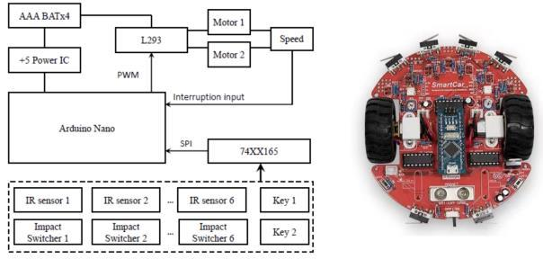

# Line-Following Smart Car

An Arduino Nano line-following project using infrared inputs, a shift-register sensor interface, signed motor PWM and NeoPixel status indicators on a SmartELab educational car platform.

Our team assembled and tested the car and developed its line-following behavior. This repository presents the supplied controller and support files, with an English reading guide and a verified Nano build. It does not republish the coursework report or the kit manual.

## Start here

| To review… | Open… |
|---|---|
| The complete Arduino sketch and support files | [Firmware guide](firmware/line_following_car/README.md) |
| Control decisions, sensor mapping and motor pins | [Design notes](docs/design.md) |
| Build results, host checks and remaining limits | [Verification](docs/verification.md) |
| Bundled library attribution | [Third-party notices](THIRD_PARTY_NOTICES.md) |



*Platform overview from the supplied project report. The diagram is a reference illustration; the source code's sensor mapping is documented separately.*

## Controller behavior

- Follow the center infrared input with equal forward PWM.
- Select progressively stronger corrections from inner, middle and outer left/right inputs.
- After more than **500 ms** without a detected line, enter a clockwise search using targets **+120 / −120**.
- Limit command changes to **20 PWM units per loop iteration** to soften transitions.
- Show detected sensor positions/state through two NeoPixels and print serial diagnostics at approximately 100 ms intervals.

The sketch defines `FOLLOWING_LINE`, `SEARCHING_LINE` and `LOST`. **`LOST` has no incoming transition in the supplied code:** search does not automatically time out into a stop. While briefly missing the line in `FOLLOWING_LINE`, the motor target is zero and the ramp reduces the previous command. These details matter when assessing the actual controller rather than only its state names.

## Build

The project report identifies Arduino Nano. A PlatformIO configuration was added for the ATmega328P Nano target:

```bash
pio run -e nanoatmega328
```

All sketch-local `.h` and `.cpp` files, including the supplied NeoPixel snapshot, are present in `firmware/line_following_car/`. There are no extra libraries to download beyond the Arduino AVR framework/toolchain used by PlatformIO.

Alternatively, open `firmware/line_following_car/line_following_car.ino` in Arduino IDE, select the actual Nano board/processor variant, and keep the sibling source files together. Upload/bootloader selection must match the physical board; no board was flashed during repository preparation. Serial output uses **9600 baud**.

## Verified results

| Check | Result |
|---|---|
| Nano firmware compile/link | Passed |
| AVR RAM / flash | **326 / 2048 bytes**, **5714 / 30720 bytes** |
| Host control checks | **6 scenario groups passed**, exercising the actual sketch functions |
| Physical track or speed benchmark | Not rerun; no lap time, success rate or speed measurement is claimed |

Run the host checks with a C++ compiler and Python 3:

```bash
python3 tests/run_host_checks.py
```

The harness substitutes the hardware APIs and does not test sensors, motor drivers, interrupt timing or real traction. See [verification details](docs/verification.md).

## Scope and limitations

The executable source reads **seven software IR channels**, six collision switches and two keys. The kit/report descriptions contain different IR counts; the supplied code mapping is retained rather than inferred from a generic board illustration.

The loop does not use collision inputs for obstacle avoidance. Wheel encoder and distance-control helpers are included, but the main follower calls `motor_set_PWM()` directly: it is not a closed-loop wheel-speed or PID controller. The PWM ramp is loop-based, not a fixed acceleration in physical units.

No track dataset, CAD/PCB source or project demonstration video was supplied for this car. No behavior has been added merely to match claims in a report. Preparation changes are limited to source layout, English comments, portable Arduino include casing and build/verification entry points.
