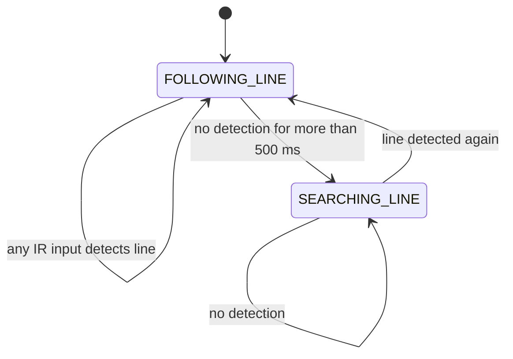

# Control and hardware notes

## State and command sequence

Each loop reads the shift registers, updates state, calculates/rate-limits motor commands, updates LEDs and occasionally prints diagnostics.

The defined `LOST` state is omitted from the reachable-state diagram because no source transition enters it. If assigned externally, its command target is zero, approached through the same PWM ramp. There is no implemented long-search stop timeout.

## Line-following decisions

The center input has priority; the left branch is checked before the right branch when multiple side inputs are active.

| Detection | Left / right target |
|---|---|
| Center | 150 / 150 |
| Inner left | 75 / 200 |
| Middle left | 50 / 200 |
| Outer left | −255 / 255 |
| Inner right | 200 / 75 |
| Middle right | 200 / 50 |
| Outer right | 255 / −255 |
| Search | 120 / −120 |
| No line while still in FOLLOWING_LINE | 0 / 0 |

These are signed source command values, not measured wheel speeds. `smoothSpeed()` moves each previous command toward its target by at most 20 per iteration without overshooting. Loop duration varies with I/O, so this is not a time-normalized acceleration bound.

## Sensor bus

`comm.cpp` latches and clocks two bytes from the parallel-input shift registers. The first byte's bits 0–6 map to outer-left, middle-left, inner-left, center, inner-right, middle-right and outer-right respectively. The second byte maps active-low collision inputs to bits 0–5 and active-low keys to bits 6–7.

The main line-following loop uses only the IR fields. Decoded collision switches are available but do not trigger avoidance behavior. Manual/report figures describe other sensor counts; physical board mapping must be checked against the actual kit revision.

## Pin map retained from the source

| Function | Arduino pin |
|---|---|
| Shift-register parallel load | D8 |
| Shift-register serial data | D12 |
| Shift-register clock | D13 |
| Left motor PWM / direction | D6 / D7 |
| Right motor PWM / direction | D9 / D10 |
| Encoder interrupts | interrupt 0 / 1, corresponding to D2 / D3 on the Nano target |
| Two NeoPixels | D4 |
| Serial diagnostics | 9600 baud |

`motor_set_PWM()` uses different left/right H-bridge polarity mappings; these are preserved rather than replaced with a generic motor formula. The project report identifies an LM7805-regulated logic supply and an L293-family motor driver. No exact motor rating, battery configuration or as-built schematic is inferred beyond those materials.

## Encoder helper boundary

`motor.cpp` attaches encoder callbacks and includes `motor_step()` for historical velocity/distance operation. The active follower bypasses that helper and writes signed PWM directly. The helper retains blocking pulse-count loops without timeout, legacy ISR/shared-counter assumptions and interval calculations that require review before physical reuse. No claim of closed-loop speed regulation, odometry or measured travel distance is made for the main sketch.

## Original project observations

The report describes repairing a poor solder joint on an IR input and tuning different turn strengths, the line-loss threshold and command smoothing. These are qualitative development observations; no underlying track log or quantitative before/after benchmark is available.

The platform is the SmartELab educational SmartCar kit. The kit manual was used to identify that context and source attribution, not republished or presented as the team's original hardware design.
